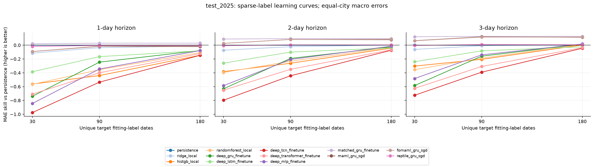
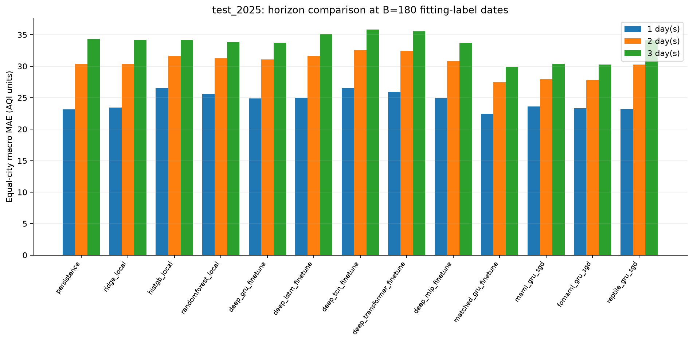
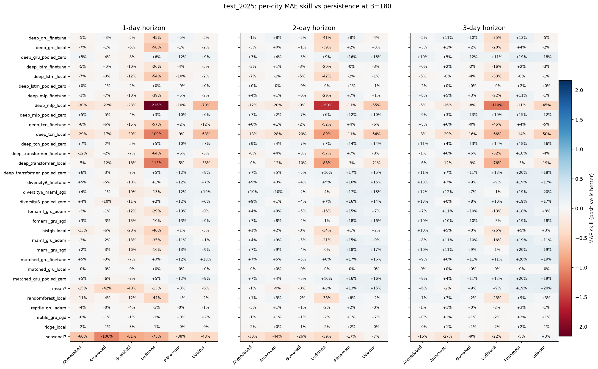
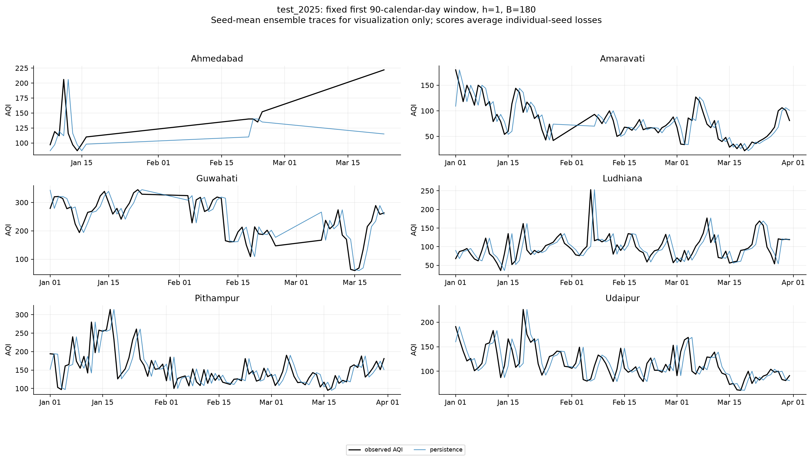

# Fixed-cohort AQI forecasting results

The primary held-out result period is **test_2025**, covering **6 selected target cities**, one station per city, horizons [1, 2, 3], fitting-label budgets [30, 90, 180] and seeds [17, 43, 71]. All values below are calculated from the supplied, unclipped forecasts. This report does not select or train a model.

## Evaluation integrity

- 2,692,602 prediction rows; 33 methods. Exact prediction keys are paired across methods; truth, issue-day AQI and dates agree across methods, budgets and seeds.
- The method and period sets match the frozen protocol. Every forecast issue date is after the latest fitting cutoff, 2023-12-31.
- Target dates are fixed across label budgets and seeds and across horizons.
- Exact comparison with the supplied source truth/context table: passed.
- MAE, RMSE and signed bias use AQI units. Bias is prediction minus observation. City errors receive equal macro weight; a long station series does not become another city.
- Losses are averaged across seeds at each city/target-date before inference. Seeds are repeated fits, not independent locations. RMSE is the square root of seed-and-date mean squared loss within a city, then averaged over cities; it is not an ensemble-prediction score.
- Paired 95% percentile intervals use 1,000 moving-block resamples of 14 contiguous calendar days within each city, followed by a fixed-city macro average. Missing calendar days retain their positions. This addresses temporal dependence and overlapping windows, conditional on these cities; cities are not resampled.

## Primary held-out performance

The lowest observed macro MAE in each budget/horizon cell is descriptive. Comparing many methods after seeing test results does not make the winner a separately validated deployment choice.

| budget | horizon | method | mae | rmse | bias | skill_mae | cities_improved_vs_persistence | n_cities |
| --- | --- | --- | --- | --- | --- | --- | --- | --- |
| 30 | 1 | deep_tcn_pooled_zero | 22.325 | 31.943 | 1.498 | 0.035 | 4 | 6 |
| 30 | 2 | deep_transformer_pooled_zero | 27.525 | 38.093 | 0.599 | 0.093 | 6 | 6 |
| 30 | 3 | deep_transformer_pooled_zero | 29.851 | 40.778 | 1.189 | 0.130 | 6 | 6 |
| 90 | 1 | deep_tcn_pooled_zero | 22.325 | 31.943 | 1.498 | 0.035 | 4 | 6 |
| 90 | 2 | matched_gru_finetune | 27.484 | 38.107 | 1.617 | 0.095 | 6 | 6 |
| 90 | 3 | deep_transformer_pooled_zero | 29.851 | 40.778 | 1.189 | 0.130 | 6 | 6 |
| 180 | 1 | deep_tcn_pooled_zero | 22.325 | 31.943 | 1.498 | 0.035 | 4 | 6 |
| 180 | 2 | matched_gru_finetune | 27.495 | 38.117 | 1.454 | 0.094 | 6 | 6 |
| 180 | 3 | deep_transformer_pooled_zero | 29.851 | 40.778 | 1.189 | 0.130 | 6 | 6 |

Across the 288 method/budget/horizon primary comparisons, 123 have lower macro MAE than persistence. The cell-level comparison tables are the evidence; this count is not a sample of independent experiments.

### Paired differences

Differences are **method minus reference**, so negative MAE differences favor the method. An interval crossing zero leaves the direction unresolved under this temporal resampling procedure. Intervals are descriptive and unadjusted for the many comparisons.

| budget | horizon | method | reference | delta_mae | delta_mae_ci_low | delta_mae_ci_high | cities_improved | n_cities |
| --- | --- | --- | --- | --- | --- | --- | --- | --- |
| 30 | 1 | deep_gru_finetune | deep_gru_pooled_zero | 17.783 | 14.471 | 20.285 | 0 | 6 |
| 30 | 1 | deep_lstm_finetune | deep_lstm_pooled_zero | 8.804 | 7.272 | 10.372 | 0 | 6 |
| 30 | 1 | deep_mlp_finetune | deep_mlp_pooled_zero | 20.098 | 17.010 | 22.419 | 0 | 6 |
| 30 | 1 | deep_tcn_finetune | deep_tcn_pooled_zero | 23.359 | 19.399 | 25.972 | 0 | 6 |
| 30 | 1 | deep_transformer_finetune | deep_transformer_pooled_zero | 17.080 | 14.189 | 19.194 | 0 | 6 |
| 30 | 1 | diversity6_finetune | diversity6_pooled_zero | -0.056 | -0.233 | 0.040 | 2 | 6 |
| 30 | 1 | matched_gru_finetune | matched_gru_pooled_zero | 0.153 | -0.040 | 0.245 | 1 | 6 |
| 30 | 2 | deep_gru_finetune | deep_gru_pooled_zero | 21.956 | 18.011 | 25.150 | 0 | 6 |
| 30 | 2 | deep_lstm_finetune | deep_lstm_pooled_zero | 8.007 | 5.997 | 9.513 | 0 | 6 |
| 30 | 2 | deep_mlp_finetune | deep_mlp_pooled_zero | 20.097 | 16.282 | 22.464 | 0 | 6 |
| 30 | 2 | deep_tcn_finetune | deep_tcn_pooled_zero | 26.963 | 21.773 | 30.132 | 0 | 6 |
| 30 | 2 | deep_transformer_finetune | deep_transformer_pooled_zero | 22.619 | 18.743 | 25.599 | 0 | 6 |
| 30 | 2 | diversity6_finetune | diversity6_pooled_zero | -0.001 | -0.223 | 0.109 | 2 | 6 |
| 30 | 2 | matched_gru_finetune | matched_gru_pooled_zero | 0.131 | -0.108 | 0.218 | 2 | 6 |
| 30 | 3 | deep_gru_finetune | deep_gru_pooled_zero | 24.404 | 20.315 | 28.049 | 0 | 6 |
| 30 | 3 | deep_lstm_finetune | deep_lstm_pooled_zero | 8.480 | 6.234 | 10.281 | 0 | 6 |
| 30 | 3 | deep_mlp_finetune | deep_mlp_pooled_zero | 20.186 | 16.573 | 22.657 | 0 | 6 |
| 30 | 3 | deep_tcn_finetune | deep_tcn_pooled_zero | 29.166 | 23.816 | 32.550 | 0 | 6 |
| 30 | 3 | deep_transformer_finetune | deep_transformer_pooled_zero | 25.910 | 21.746 | 29.843 | 0 | 6 |
| 30 | 3 | diversity6_finetune | diversity6_pooled_zero | -0.032 | -0.296 | 0.114 | 2 | 6 |
| 30 | 3 | matched_gru_finetune | matched_gru_pooled_zero | 0.113 | -0.155 | 0.198 | 2 | 6 |
| 90 | 1 | deep_gru_finetune | deep_gru_pooled_zero | 6.354 | 4.260 | 7.443 | 0 | 6 |
| 90 | 1 | deep_lstm_finetune | deep_lstm_pooled_zero | 3.746 | 2.455 | 4.524 | 0 | 6 |
| 90 | 1 | deep_mlp_finetune | deep_mlp_pooled_zero | 8.544 | 6.001 | 9.830 | 0 | 6 |
| 90 | 1 | deep_tcn_finetune | deep_tcn_pooled_zero | 13.175 | 10.183 | 14.756 | 0 | 6 |
| 90 | 1 | deep_transformer_finetune | deep_transformer_pooled_zero | 9.917 | 7.466 | 11.480 | 0 | 6 |
| 90 | 1 | diversity6_finetune | diversity6_pooled_zero | -0.201 | -0.295 | -0.141 | 4 | 6 |
| 90 | 1 | matched_gru_finetune | matched_gru_pooled_zero | -0.029 | -0.133 | 0.031 | 3 | 6 |
| 90 | 2 | deep_gru_finetune | deep_gru_pooled_zero | 8.590 | 5.941 | 10.109 | 0 | 6 |
| 90 | 2 | deep_lstm_finetune | deep_lstm_pooled_zero | 3.142 | 1.802 | 3.773 | 0 | 6 |
| 90 | 2 | deep_mlp_finetune | deep_mlp_pooled_zero | 8.581 | 5.910 | 9.910 | 0 | 6 |
| 90 | 2 | deep_tcn_finetune | deep_tcn_pooled_zero | 16.214 | 12.478 | 18.404 | 0 | 6 |
| 90 | 2 | deep_transformer_finetune | deep_transformer_pooled_zero | 13.440 | 10.501 | 15.606 | 0 | 6 |
| 90 | 2 | diversity6_finetune | diversity6_pooled_zero | -0.163 | -0.289 | -0.099 | 5 | 6 |
| 90 | 2 | matched_gru_finetune | matched_gru_pooled_zero | -0.059 | -0.200 | -0.009 | 3 | 6 |
| 90 | 3 | deep_gru_finetune | deep_gru_pooled_zero | 9.808 | 6.926 | 11.905 | 0 | 6 |
| 90 | 3 | deep_lstm_finetune | deep_lstm_pooled_zero | 3.060 | 1.532 | 3.826 | 0 | 6 |
| 90 | 3 | deep_mlp_finetune | deep_mlp_pooled_zero | 8.420 | 5.853 | 10.055 | 0 | 6 |
| 90 | 3 | deep_tcn_finetune | deep_tcn_pooled_zero | 17.703 | 13.513 | 20.290 | 0 | 6 |
| 90 | 3 | deep_transformer_finetune | deep_transformer_pooled_zero | 15.033 | 12.173 | 17.918 | 0 | 6 |
| 90 | 3 | diversity6_finetune | diversity6_pooled_zero | -0.227 | -0.379 | -0.138 | 5 | 6 |
| 90 | 3 | matched_gru_finetune | matched_gru_pooled_zero | -0.083 | -0.239 | -0.025 | 4 | 6 |
| 180 | 1 | deep_gru_finetune | deep_gru_pooled_zero | 2.456 | 1.344 | 3.155 | 2 | 6 |
| 180 | 1 | deep_lstm_finetune | deep_lstm_pooled_zero | 1.783 | 1.241 | 2.203 | 1 | 6 |
| 180 | 1 | deep_mlp_finetune | deep_mlp_pooled_zero | 2.397 | 1.100 | 2.887 | 0 | 6 |
| 180 | 1 | deep_tcn_finetune | deep_tcn_pooled_zero | 4.182 | 2.595 | 5.034 | 0 | 6 |
| 180 | 1 | deep_transformer_finetune | deep_transformer_pooled_zero | 3.513 | 2.219 | 4.372 | 2 | 6 |
| 180 | 1 | diversity6_finetune | diversity6_pooled_zero | -0.165 | -0.250 | -0.107 | 4 | 6 |
| 180 | 1 | matched_gru_finetune | matched_gru_pooled_zero | -0.040 | -0.136 | 0.016 | 4 | 6 |
| 180 | 2 | deep_gru_finetune | deep_gru_pooled_zero | 3.513 | 2.060 | 4.495 | 2 | 6 |
| 180 | 2 | deep_lstm_finetune | deep_lstm_pooled_zero | 1.326 | 0.719 | 1.774 | 1 | 6 |
| 180 | 2 | deep_mlp_finetune | deep_mlp_pooled_zero | 2.711 | 1.239 | 3.333 | 0 | 6 |
| 180 | 2 | deep_tcn_finetune | deep_tcn_pooled_zero | 5.006 | 3.022 | 6.208 | 0 | 6 |
| 180 | 2 | deep_transformer_finetune | deep_transformer_pooled_zero | 4.863 | 3.187 | 6.146 | 0 | 6 |
| 180 | 2 | diversity6_finetune | diversity6_pooled_zero | -0.119 | -0.236 | -0.060 | 4 | 6 |
| 180 | 2 | matched_gru_finetune | matched_gru_pooled_zero | -0.047 | -0.172 | 0.009 | 4 | 6 |
| 180 | 3 | deep_gru_finetune | deep_gru_pooled_zero | 3.774 | 1.882 | 5.008 | 1 | 6 |
| 180 | 3 | deep_lstm_finetune | deep_lstm_pooled_zero | 1.060 | 0.278 | 1.579 | 2 | 6 |
| 180 | 3 | deep_mlp_finetune | deep_mlp_pooled_zero | 3.013 | 1.337 | 3.820 | 1 | 6 |
| 180 | 3 | deep_tcn_finetune | deep_tcn_pooled_zero | 5.820 | 3.354 | 7.288 | 1 | 6 |
| 180 | 3 | deep_transformer_finetune | deep_transformer_pooled_zero | 5.697 | 3.672 | 7.411 | 0 | 6 |
| 180 | 3 | diversity6_finetune | diversity6_pooled_zero | -0.162 | -0.292 | -0.081 | 4 | 6 |
| 180 | 3 | matched_gru_finetune | matched_gru_pooled_zero | -0.068 | -0.211 | -0.006 | 4 | 6 |

## What the project questions can support

**Does pretraining beat training from scratch?** The direct paired comparisons below use the same architecture, target label budget, input information and evaluation dates. Pooled zero-shot has donor fitting labels only; fine-tuning adds the permitted target budget. Local scratch uses that target budget without pretraining. These compare fitting strategies, not equal total numbers of source and target examples.

Pooled zero-shot has lower observed macro MAE than its matched local scratch model in 54/54 architecture/budget/horizon cells; 51 have entirely negative temporal intervals. A gain over scratch alone does not establish a useful gain over persistence.

Fine-tuning has lower observed macro MAE than its matched local scratch model in 48/54 architecture/budget/horizon cells; 40 have entirely negative temporal intervals. A gain over scratch alone does not establish a useful gain over persistence.

| kind | method | reference | cells | mean_delta_mae_across_cells | cells_with_lower_mae | cells_with_entirely_negative_interval |
| --- | --- | --- | --- | --- | --- | --- |
| finetune_minus_local | deep_gru_finetune | deep_gru_local | 9 | 0.520 | 6 | 3 |
| finetune_minus_local | deep_lstm_finetune | deep_lstm_local | 9 | -7.168 | 9 | 9 |
| finetune_minus_local | deep_mlp_finetune | deep_mlp_local | 9 | -9.097 | 9 | 8 |
| finetune_minus_local | deep_tcn_finetune | deep_tcn_local | 9 | -7.271 | 9 | 9 |
| finetune_minus_local | deep_transformer_finetune | deep_transformer_local | 9 | -1.601 | 6 | 5 |
| finetune_minus_local | matched_gru_finetune | matched_gru_local | 9 | -2.596 | 9 | 6 |
| pooled_zero_minus_local | deep_gru_pooled_zero | deep_gru_local | 9 | -10.440 | 9 | 9 |
| pooled_zero_minus_local | deep_lstm_pooled_zero | deep_lstm_local | 9 | -11.547 | 9 | 9 |
| pooled_zero_minus_local | deep_mlp_pooled_zero | deep_mlp_local | 9 | -19.547 | 9 | 9 |
| pooled_zero_minus_local | deep_tcn_pooled_zero | deep_tcn_local | 9 | -23.003 | 9 | 9 |
| pooled_zero_minus_local | deep_transformer_pooled_zero | deep_transformer_local | 9 | -14.720 | 9 | 9 |
| pooled_zero_minus_local | matched_gru_pooled_zero | matched_gru_local | 9 | -2.604 | 9 | 6 |

The across-cell mean is a descriptive summary of related budget/horizon settings; it is not a new independent-city estimate. Complete paired cell intervals are in `paired_comparisons.csv`.
**Does fine-tuning help over the pooled model?** Fine-tuning has lower observed macro MAE in 15/63 architecture/budget/horizon cells; 9 have an entirely negative temporal interval. The individual cell and city results show where adaptation helps or harms; a common advantage is not assumed.

**Can transfer help when target fitting labels are scarce?** The budgets count unique target fitting-label dates, with each selected date used for the three horizon labels. Models may use the complete observed recent input context at forecast time. This simulates limited fitting labels, not a monitoring station with no recent observations. The most recent B fitting dates also change recency and seasonal composition, so budget differences are not a causal effect of label count alone.

**Are these 24–72-hour forecasts?** Horizons 1–3 predict future daily AQI labels and are approximately 24–72 hours relative to the source's nominal 4 PM daily convention. Exact operational issue latency and real-time availability are not established. Inputs are past observed AQI; no pollutant or weather timing claim is implied.

**Do models forecast an unseen place?** Pooled zero-shot omits target fitting labels, but still consumes the target station's recent observed AQI. Fine-tuning and local models use target labels. This is held-out-city transfer conditional on recent target inputs, not a forecast for a place with no monitoring history.

**Can this be generalized nationally or causally?** The selected cities are a coverage-based study cohort, not a representative national sample. One station does not measure a city's full spatial exposure. Temporal intervals condition on these locations. Coverage selection, source missingness, overlapping windows, shared donor pretraining and budget recency limit causal and national claims.

## Seasonal and high-AQI checks

Winter is December–February; monsoon is June–September; other months form a third group. The high-AQI subgroup uses the **observed target AQI >= 200**, not a forecast-triggered alert. Subgroup macro errors average only cities with eligible observations; city/date counts accompany every row. Seasonal differences are descriptive and do not identify a transfer mechanism.

| method | subgroup_type | subgroup | n_cities | n_city_dates | mae | rmse | bias | skill_mae |
| --- | --- | --- | --- | --- | --- | --- | --- | --- |
| persistence | observed_target_aqi | AQI < 200 | 6 | 1320 | 20.890 | 31.483 | 4.191 | 0.000 |
| persistence | observed_target_aqi | AQI >= 200 | 6 | 106 | 65.110 | 77.204 | -52.631 | 0.000 |
| persistence | season | monsoon | 6 | 434 | 17.702 | 29.251 | 1.364 | 0.000 |
| persistence | season | other | 6 | 571 | 24.874 | 36.105 | -0.608 | 0.000 |
| persistence | season | winter | 6 | 421 | 26.658 | 37.556 | -0.318 | 0.000 |

## Secondary periods

The following periods are separate robustness evaluations. In particular, **secondary_2024 is not used for tuning, early stopping, architecture selection or budget selection**. Do not pool it with the primary 2025 test when reporting the main result.

| period | budget | horizon | method | mae | rmse | skill_mae |
| --- | --- | --- | --- | --- | --- | --- |
| secondary_2024 | 30 | 1 | deep_gru_pooled_zero | 21.941 | 30.870 | 0.041 |
| secondary_2024 | 30 | 2 | diversity6_maml_sgd | 25.911 | 35.464 | 0.094 |
| secondary_2024 | 30 | 3 | diversity6_maml_sgd | 27.911 | 38.136 | 0.120 |
| secondary_2024 | 90 | 1 | deep_gru_pooled_zero | 21.941 | 30.870 | 0.041 |
| secondary_2024 | 90 | 2 | maml_gru_sgd | 25.436 | 34.936 | 0.110 |
| secondary_2024 | 90 | 3 | maml_gru_sgd | 27.615 | 37.724 | 0.129 |
| secondary_2024 | 180 | 1 | deep_gru_pooled_zero | 21.941 | 30.870 | 0.041 |
| secondary_2024 | 180 | 2 | maml_gru_sgd | 25.327 | 34.904 | 0.114 |
| secondary_2024 | 180 | 3 | maml_gru_sgd | 27.488 | 37.646 | 0.133 |

## Eligibility, implementation costs and reproducibility

Eligibility and gap exclusions come from the preprocessing audit, not from model success. See `eligibility_counts.csv` / `eligibility_counts.json` when supplied. A missing record is not proof of monitoring downtime or naturally scarce labels. No missing AQI value is imputed by this evaluator; it scores only the common observed targets.

Training durations, trainable parameter counts and fit status are recorded in `fit_costs` and `parameter_counts` artifacts when supplied. Repeated deterministic baseline seeds do not add independent evidence. Protocol/source hashes and execution environment belong in the run metadata alongside these results.

The forecast traces average predictions across seeds for an ensemble visualization only; the reported errors instead average each seed's losses and do not score that ensemble.

### Recorded implementation costs

Durations sum the recorded fits within each stage/method/architecture. Shared donor fitting stays in its own stage and is not multiplied by the number of target forecasts. Parameter counts describe a model, not a quantity to sum across fits. `fit_seconds` records fitting routines, including checkpoint evaluation during donor selection; target `block_seconds` additionally includes prediction/artifact work and is reported separately, never added to fitting time. These are hardware- and run-specific measurements, not an algorithmic efficiency guarantee. Missing timing or parameter entries are unknown rather than zero.

| stage | method | architecture | fit_records | total_fit_seconds | median_fit_seconds | parameters_min | parameters_max | total_block_seconds |
| --- | --- | --- | --- | --- | --- | --- | --- | --- |
| donor_adaptation_candidate | deep_gru_finetune | deep_gru | 48 | 103.278 | 2.502 | 151681.000 | 151681.000 | NA |
| donor_adaptation_candidate | deep_gru_local | deep_gru | 48 | 94.261 | 1.705 | 151681.000 | 151681.000 | NA |
| donor_adaptation_candidate | deep_lstm_finetune | deep_lstm | 48 | 145.853 | 2.610 | 487874.000 | 487874.000 | NA |
| donor_adaptation_candidate | deep_lstm_local | deep_lstm | 48 | 138.887 | 2.111 | 487874.000 | 487874.000 | NA |
| donor_adaptation_candidate | deep_mlp_finetune | deep_mlp | 48 | 47.382 | 0.842 | 454081.000 | 454081.000 | NA |
| donor_adaptation_candidate | deep_mlp_local | deep_mlp | 48 | 76.467 | 1.592 | 454081.000 | 454081.000 | NA |
| donor_adaptation_candidate | deep_tcn_finetune | deep_tcn | 48 | 143.648 | 2.370 | 350465.000 | 350465.000 | NA |
| donor_adaptation_candidate | deep_tcn_local | deep_tcn | 48 | 187.280 | 3.242 | 350465.000 | 350465.000 | NA |
| donor_adaptation_candidate | deep_transformer_finetune | deep_transformer | 48 | 190.008 | 3.437 | 596097.000 | 596097.000 | NA |
| donor_adaptation_candidate | deep_transformer_local | deep_transformer | 48 | 275.725 | 5.168 | 596097.000 | 596097.000 | NA |
| donor_adaptation_candidate | fomaml_gru_adam | matched_manual_gru | 48 | 19.807 | 0.474 | 38849.000 | 38849.000 | NA |
| donor_adaptation_candidate | fomaml_gru_sgd | matched_manual_gru | 48 | 5.718 | 0.109 | 38849.000 | 38849.000 | NA |
| donor_adaptation_candidate | maml_gru_adam | matched_manual_gru | 48 | 19.125 | 0.405 | 38849.000 | 38849.000 | NA |
| donor_adaptation_candidate | maml_gru_sgd | matched_manual_gru | 48 | 4.939 | 0.123 | 38849.000 | 38849.000 | NA |
| donor_adaptation_candidate | matched_gru_finetune | matched_manual_gru | 48 | 5.817 | 0.127 | 38849.000 | 38849.000 | NA |
| donor_adaptation_candidate | matched_gru_local | matched_manual_gru | 48 | 5.565 | 0.137 | 38849.000 | 38849.000 | NA |
| donor_adaptation_candidate | reptile_gru_adam | matched_manual_gru | 48 | 17.338 | 0.333 | 38849.000 | 38849.000 | NA |
| donor_adaptation_candidate | reptile_gru_sgd | matched_manual_gru | 48 | 4.041 | 0.089 | 38849.000 | 38849.000 | NA |
| donor_diversity_fixed_refit | diversity6_maml | matched_manual_gru | 3 | 1320.592 | 446.575 | 38849.000 | 38849.000 | NA |
| donor_diversity_fixed_refit | diversity6_pooled | matched_manual_gru | 3 | 22.113 | 7.085 | 38849.000 | 38849.000 | NA |
| donor_fixed_refit | deep_gru | deep_gru | 3 | 76.560 | 24.337 | 151681.000 | 151681.000 | NA |
| donor_fixed_refit | deep_lstm | deep_lstm | 3 | 139.540 | 45.878 | 487874.000 | 487874.000 | NA |
| donor_fixed_refit | deep_mlp | deep_mlp | 3 | 12.418 | 3.655 | 454081.000 | 454081.000 | NA |
| donor_fixed_refit | deep_tcn | deep_tcn | 3 | 30.425 | 10.083 | 350465.000 | 350465.000 | NA |
| donor_fixed_refit | deep_transformer | deep_transformer | 3 | 115.344 | 38.003 | 596097.000 | 596097.000 | NA |
| donor_fixed_refit | matched_gru | matched_manual_gru | 3 | 23.688 | 7.308 | 38849.000 | 38849.000 | NA |
| donor_hpo_development | gru | deep_gru | 48 | 21.650 | 0.452 | 151681.000 | 338113.000 | NA |
| donor_hpo_development | lstm | deep_lstm | 48 | 20.654 | 0.432 | 218754.000 | 487874.000 | NA |
| donor_hpo_development | manual_gru | matched_manual_gru | 48 | 1.450 | 0.021 | 38849.000 | 38849.000 | NA |
| donor_hpo_development | mlp | deep_mlp | 48 | 13.644 | 0.253 | 204417.000 | 454081.000 | NA |
| donor_hpo_development | tcn | deep_tcn | 48 | 60.859 | 0.957 | 350465.000 | 783745.000 | NA |
| donor_hpo_development | transformer | deep_transformer | 48 | 70.869 | 1.284 | 596097.000 | 1336513.000 | NA |
| donor_hpo_meta | fomaml | matched_manual_gru | 4 | 559.909 | 138.472 | 38849.000 | 38849.000 | NA |
| donor_hpo_meta | maml | matched_manual_gru | 4 | 1328.110 | 345.522 | 38849.000 | 38849.000 | NA |
| donor_hpo_meta | reptile | matched_manual_gru | 4 | 357.883 | 95.130 | 38849.000 | 38849.000 | NA |
| donor_hpo_source | gru | deep_gru | 4 | 82.660 | 18.598 | 151681.000 | 338113.000 | NA |
| donor_hpo_source | lstm | deep_lstm | 4 | 100.974 | 25.027 | 218754.000 | 487874.000 | NA |
| donor_hpo_source | manual_gru | matched_manual_gru | 4 | 90.512 | 21.127 | 38849.000 | 38849.000 | NA |
| donor_hpo_source | mlp | deep_mlp | 4 | 36.581 | 8.586 | 204417.000 | 454081.000 | NA |
| donor_hpo_source | tcn | deep_tcn | 4 | 170.643 | 42.529 | 350465.000 | 783745.000 | NA |
| donor_hpo_source | transformer | deep_transformer | 4 | 323.928 | 85.031 | 596097.000 | 1336513.000 | NA |
| donor_meta_fixed_refit | fomaml | matched_manual_gru | 3 | 437.104 | 143.669 | 38849.000 | 38849.000 | NA |
| donor_meta_fixed_refit | maml | matched_manual_gru | 3 | 1055.468 | 344.256 | 38849.000 | 38849.000 | NA |
| donor_meta_fixed_refit | reptile | matched_manual_gru | 3 | 331.696 | 112.221 | 38849.000 | 38849.000 | NA |
| target_fit | deep_gru_finetune | deep_gru | 54 | 45.032 | 0.819 | 151681.000 | 151681.000 | 46.564 |
| target_fit | deep_gru_local | deep_gru | 54 | 71.331 | 1.295 | 151681.000 | 151681.000 | 75.336 |
| target_fit | deep_gru_pooled_zero | deep_gru | 54 | 0.000 | 0.000 | 151681.000 | 151681.000 | 0.997 |
| target_fit | deep_lstm_finetune | deep_lstm | 54 | 56.864 | 0.976 | 487874.000 | 487874.000 | 58.984 |
| target_fit | deep_lstm_local | deep_lstm | 54 | 107.104 | 2.070 | 487874.000 | 487874.000 | 111.204 |
| target_fit | deep_lstm_pooled_zero | deep_lstm | 54 | 0.000 | 0.000 | 487874.000 | 487874.000 | 1.249 |
| target_fit | deep_mlp_finetune | deep_mlp | 54 | 28.094 | 0.464 | 454081.000 | 454081.000 | 29.475 |
| target_fit | deep_mlp_local | deep_mlp | 54 | 108.390 | 1.842 | 454081.000 | 454081.000 | 111.753 |
| target_fit | deep_mlp_pooled_zero | deep_mlp | 54 | 0.000 | 0.000 | 454081.000 | 454081.000 | 0.906 |
| target_fit | deep_tcn_finetune | deep_tcn | 54 | 97.131 | 2.006 | 350465.000 | 350465.000 | 101.215 |
| target_fit | deep_tcn_local | deep_tcn | 54 | 388.207 | 8.071 | 350465.000 | 350465.000 | 392.421 |
| target_fit | deep_tcn_pooled_zero | deep_tcn | 54 | 0.000 | 0.000 | 350465.000 | 350465.000 | 3.356 |
| target_fit | deep_transformer_finetune | deep_transformer | 54 | 111.707 | 2.107 | 596097.000 | 596097.000 | 114.633 |
| target_fit | deep_transformer_local | deep_transformer | 54 | 158.855 | 3.111 | 596097.000 | 596097.000 | 162.497 |
| target_fit | deep_transformer_pooled_zero | deep_transformer | 54 | 0.000 | 0.000 | 596097.000 | 596097.000 | 2.267 |
| target_fit | diversity6_finetune | matched_manual_gru | 54 | 1.567 | 0.024 | 38849.000 | 38849.000 | 2.524 |

Showing 60 of 77 rows; complete results are in CSV.

Complete stage summaries are in `cost_summary.csv`; individual recorded fits are in `fit_costs.csv`.

Complete outputs: `case_metrics.csv`, `seed_averaged_date_losses.csv.gz`, `city_metrics.csv`, `macro_metrics.csv`, `paired_comparisons.csv`, `subgroup_city_metrics.csv`, `subgroup_metrics.csv`, `evaluation_checks.json`, `evaluation_protocol.json`, and `summary.json`.

## Figures

