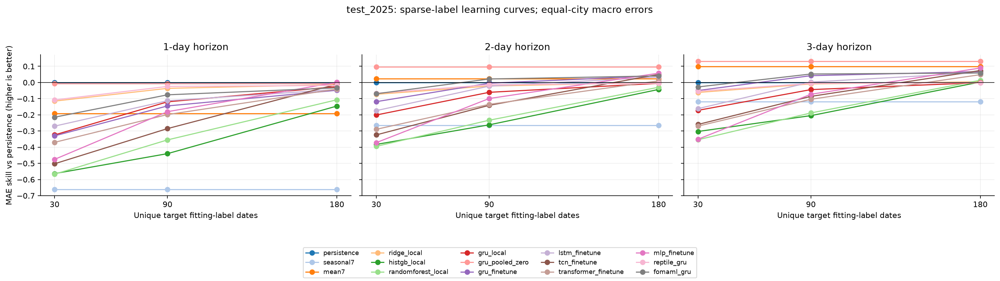
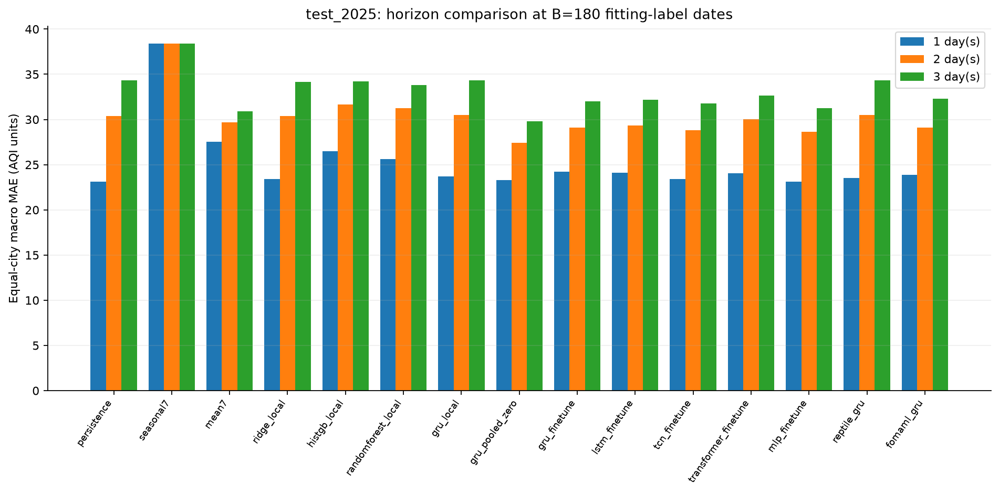
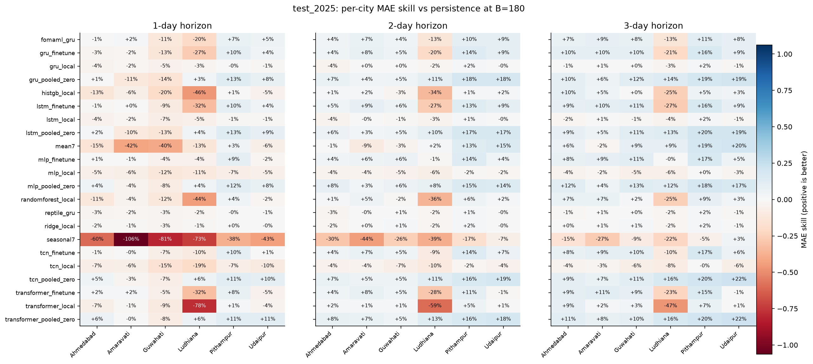
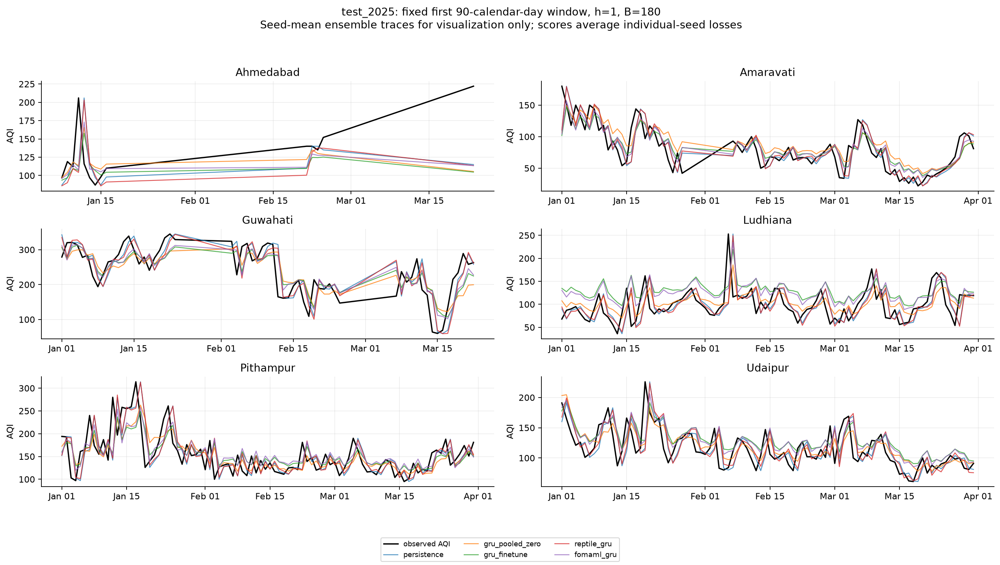

# Fixed-cohort AQI forecasting results

The primary held-out result period is **test_2025**, covering **6 selected target cities**, one station per city, horizons [1, 2, 3], fitting-label budgets [30, 90, 180] and seeds [17, 43, 71]. All values below are calculated from the supplied, unclipped forecasts. This report does not select or train a model.

## Evaluation integrity

- 1,876,662 prediction rows; 23 methods. Exact prediction keys are paired across methods; truth, issue-day AQI and dates agree across methods, budgets and seeds.
- The method and period sets match the frozen protocol. Every forecast issue date is after the latest fitting cutoff, 2023-12-31.
- Target dates are fixed across label budgets and seeds and across horizons.
- Exact comparison with the supplied source truth/context table: passed.
- MAE, RMSE and signed bias use AQI units. Bias is prediction minus observation. City errors receive equal macro weight; a long station series does not become another city.
- Losses are averaged across seeds at each city/target-date before inference. Seeds are repeated fits, not independent locations. RMSE is the square root of seed-and-date mean squared loss within a city, then averaged over cities; it is not an ensemble-prediction score.
- Paired 95% percentile intervals use 1,000 moving-block resamples of 14 contiguous calendar days within each city, followed by a fixed-city macro average. Missing calendar days retain their positions. This addresses temporal dependence and overlapping windows, conditional on these cities; cities are not resampled.

## Primary held-out performance

The lowest observed macro MAE in each budget/horizon cell is descriptive. Comparing many methods after seeing test results does not make the winner a separately validated deployment choice.

| budget | horizon | method | mae | rmse | bias | skill_mae | cities_improved_vs_persistence | n_cities |
| --- | --- | --- | --- | --- | --- | --- | --- | --- |
| 30 | 1 | transformer_pooled_zero | 22.237 | 31.968 | -3.029 | 0.038 | 4 | 6 |
| 30 | 2 | transformer_pooled_zero | 27.148 | 37.840 | -2.435 | 0.106 | 6 | 6 |
| 30 | 3 | transformer_pooled_zero | 29.509 | 40.587 | -1.765 | 0.140 | 6 | 6 |
| 90 | 1 | transformer_pooled_zero | 22.237 | 31.968 | -3.029 | 0.038 | 4 | 6 |
| 90 | 2 | transformer_pooled_zero | 27.148 | 37.840 | -2.435 | 0.106 | 6 | 6 |
| 90 | 3 | transformer_pooled_zero | 29.509 | 40.587 | -1.765 | 0.140 | 6 | 6 |
| 180 | 1 | transformer_pooled_zero | 22.237 | 31.968 | -3.029 | 0.038 | 4 | 6 |
| 180 | 2 | transformer_pooled_zero | 27.148 | 37.840 | -2.435 | 0.106 | 6 | 6 |
| 180 | 3 | transformer_pooled_zero | 29.509 | 40.587 | -1.765 | 0.140 | 6 | 6 |

Across the 198 method/budget/horizon primary comparisons, 69 have lower macro MAE than persistence. The cell-level comparison tables are the evidence; this count is not a sample of independent experiments.

### Paired differences

Differences are **method minus reference**, so negative MAE differences favor the method. An interval crossing zero leaves the direction unresolved under this temporal resampling procedure. Intervals are descriptive and unadjusted for the many comparisons.

| budget | horizon | method | reference | delta_mae | delta_mae_ci_low | delta_mae_ci_high | cities_improved | n_cities |
| --- | --- | --- | --- | --- | --- | --- | --- | --- |
| 30 | 1 | gru_finetune | gru_pooled_zero | 7.462 | 5.624 | 8.548 | 0 | 6 |
| 30 | 1 | lstm_finetune | lstm_pooled_zero | 6.333 | 4.440 | 7.350 | 0 | 6 |
| 30 | 1 | mlp_finetune | mlp_pooled_zero | 11.534 | 9.780 | 13.450 | 0 | 6 |
| 30 | 1 | tcn_finetune | tcn_pooled_zero | 12.331 | 10.372 | 14.476 | 0 | 6 |
| 30 | 1 | transformer_finetune | transformer_pooled_zero | 9.445 | 7.702 | 10.589 | 0 | 6 |
| 30 | 1 | reptile_gru | gru_finetune | -5.137 | -6.473 | -3.121 | 5 | 6 |
| 30 | 1 | fomaml_gru | gru_finetune | -2.666 | -3.700 | -1.837 | 5 | 6 |
| 30 | 2 | gru_finetune | gru_pooled_zero | 6.544 | 4.503 | 7.613 | 0 | 6 |
| 30 | 2 | lstm_finetune | lstm_pooled_zero | 8.068 | 5.400 | 9.778 | 0 | 6 |
| 30 | 2 | mlp_finetune | mlp_pooled_zero | 14.020 | 11.818 | 16.477 | 0 | 6 |
| 30 | 2 | tcn_finetune | tcn_pooled_zero | 12.893 | 10.502 | 15.396 | 0 | 6 |
| 30 | 2 | transformer_finetune | transformer_pooled_zero | 12.002 | 9.252 | 13.505 | 0 | 6 |
| 30 | 2 | reptile_gru | gru_finetune | -1.572 | -2.834 | 0.542 | 3 | 6 |
| 30 | 2 | fomaml_gru | gru_finetune | -1.485 | -2.491 | -0.607 | 5 | 6 |
| 30 | 3 | gru_finetune | gru_pooled_zero | 6.232 | 3.951 | 7.592 | 0 | 6 |
| 30 | 3 | lstm_finetune | lstm_pooled_zero | 9.968 | 6.660 | 12.374 | 0 | 6 |
| 30 | 3 | mlp_finetune | mlp_pooled_zero | 16.382 | 13.683 | 19.466 | 0 | 6 |
| 30 | 3 | tcn_finetune | tcn_pooled_zero | 13.674 | 10.906 | 16.368 | 0 | 6 |
| 30 | 3 | transformer_finetune | transformer_pooled_zero | 14.056 | 10.906 | 16.100 | 0 | 6 |
| 30 | 3 | reptile_gru | gru_finetune | 0.141 | -1.345 | 2.617 | 3 | 6 |
| 30 | 3 | fomaml_gru | gru_finetune | -0.763 | -1.573 | 0.157 | 4 | 6 |
| 90 | 1 | gru_finetune | gru_pooled_zero | 3.182 | 1.669 | 4.002 | 2 | 6 |
| 90 | 1 | lstm_finetune | lstm_pooled_zero | 2.703 | 1.334 | 3.337 | 2 | 6 |
| 90 | 1 | mlp_finetune | mlp_pooled_zero | 4.714 | 3.039 | 6.035 | 0 | 6 |
| 90 | 1 | tcn_finetune | tcn_pooled_zero | 7.301 | 5.375 | 9.016 | 0 | 6 |
| 90 | 1 | transformer_finetune | transformer_pooled_zero | 5.473 | 3.784 | 6.596 | 0 | 6 |
| 90 | 1 | reptile_gru | gru_finetune | -2.789 | -3.787 | -1.280 | 6 | 6 |
| 90 | 1 | fomaml_gru | gru_finetune | -1.589 | -2.100 | -0.895 | 6 | 6 |
| 90 | 2 | gru_finetune | gru_pooled_zero | 3.085 | 1.513 | 3.821 | 1 | 6 |
| 90 | 2 | lstm_finetune | lstm_pooled_zero | 3.472 | 1.776 | 4.232 | 1 | 6 |
| 90 | 2 | mlp_finetune | mlp_pooled_zero | 5.737 | 3.532 | 7.219 | 0 | 6 |
| 90 | 2 | tcn_finetune | tcn_pooled_zero | 7.340 | 5.241 | 8.951 | 0 | 6 |
| 90 | 2 | transformer_finetune | transformer_pooled_zero | 7.316 | 4.999 | 8.825 | 0 | 6 |
| 90 | 2 | reptile_gru | gru_finetune | 0.279 | -0.731 | 1.959 | 1 | 6 |
| 90 | 2 | fomaml_gru | gru_finetune | -0.799 | -1.319 | -0.082 | 4 | 6 |
| 90 | 3 | gru_finetune | gru_pooled_zero | 3.079 | 1.486 | 3.977 | 0 | 6 |
| 90 | 3 | lstm_finetune | lstm_pooled_zero | 4.328 | 2.293 | 5.367 | 0 | 6 |
| 90 | 3 | mlp_finetune | mlp_pooled_zero | 6.838 | 4.361 | 8.752 | 0 | 6 |
| 90 | 3 | tcn_finetune | tcn_pooled_zero | 7.720 | 5.357 | 9.594 | 0 | 6 |
| 90 | 3 | transformer_finetune | transformer_pooled_zero | 8.353 | 5.771 | 10.215 | 0 | 6 |
| 90 | 3 | reptile_gru | gru_finetune | 1.631 | 0.541 | 3.374 | 1 | 6 |
| 90 | 3 | fomaml_gru | gru_finetune | -0.354 | -0.798 | 0.311 | 3 | 6 |
| 180 | 1 | gru_finetune | gru_pooled_zero | 0.939 | -0.022 | 1.527 | 2 | 6 |
| 180 | 1 | lstm_finetune | lstm_pooled_zero | 1.092 | 0.118 | 1.726 | 2 | 6 |
| 180 | 1 | mlp_finetune | mlp_pooled_zero | 0.522 | -0.142 | 0.910 | 2 | 6 |
| 180 | 1 | tcn_finetune | tcn_pooled_zero | 0.968 | 0.136 | 1.397 | 2 | 6 |
| 180 | 1 | transformer_finetune | transformer_pooled_zero | 1.829 | 0.801 | 2.503 | 2 | 6 |
| 180 | 1 | reptile_gru | gru_finetune | -0.687 | -1.502 | 0.590 | 2 | 6 |
| 180 | 1 | fomaml_gru | gru_finetune | -0.343 | -0.700 | 0.127 | 5 | 6 |
| 180 | 2 | gru_finetune | gru_pooled_zero | 1.670 | 0.612 | 2.302 | 2 | 6 |
| 180 | 2 | lstm_finetune | lstm_pooled_zero | 1.772 | 0.602 | 2.491 | 2 | 6 |
| 180 | 2 | mlp_finetune | mlp_pooled_zero | 0.986 | 0.175 | 1.587 | 1 | 6 |
| 180 | 2 | tcn_finetune | tcn_pooled_zero | 1.533 | 0.566 | 2.097 | 1 | 6 |
| 180 | 2 | transformer_finetune | transformer_pooled_zero | 2.912 | 1.754 | 3.814 | 1 | 6 |
| 180 | 2 | reptile_gru | gru_finetune | 1.423 | 0.600 | 2.823 | 1 | 6 |
| 180 | 2 | fomaml_gru | gru_finetune | 0.040 | -0.305 | 0.535 | 1 | 6 |
| 180 | 3 | gru_finetune | gru_pooled_zero | 2.211 | 0.999 | 2.898 | 1 | 6 |
| 180 | 3 | lstm_finetune | lstm_pooled_zero | 2.318 | 0.796 | 3.173 | 1 | 6 |
| 180 | 3 | mlp_finetune | mlp_pooled_zero | 1.275 | 0.204 | 2.028 | 1 | 6 |
| 180 | 3 | tcn_finetune | tcn_pooled_zero | 2.234 | 0.984 | 2.995 | 1 | 6 |
| 180 | 3 | transformer_finetune | transformer_pooled_zero | 3.139 | 1.654 | 4.233 | 1 | 6 |
| 180 | 3 | reptile_gru | gru_finetune | 2.366 | 1.523 | 4.039 | 1 | 6 |
| 180 | 3 | fomaml_gru | gru_finetune | 0.297 | -0.030 | 0.806 | 1 | 6 |

## What the project questions can support

**Does pretraining beat training from scratch?** The direct paired comparisons below use the same architecture, target label budget, input information and evaluation dates. Pooled zero-shot has donor fitting labels only; fine-tuning adds the permitted target budget. Local scratch uses that target budget without pretraining. These compare fitting strategies, not equal total numbers of source and target examples.

Pooled zero-shot has lower observed macro MAE than its matched local scratch model in 45/45 architecture/budget/horizon cells; 43 have entirely negative temporal intervals. A gain over scratch alone does not establish a useful gain over persistence.

Fine-tuning has lower observed macro MAE than its matched local scratch model in 40/45 architecture/budget/horizon cells; 34 have entirely negative temporal intervals. A gain over scratch alone does not establish a useful gain over persistence.

| kind | method | reference | cells | mean_delta_mae_across_cells | cells_with_lower_mae | cells_with_entirely_negative_interval |
| --- | --- | --- | --- | --- | --- | --- |
| finetune_minus_local | gru_finetune | gru_local | 9 | -1.545 | 6 | 6 |
| finetune_minus_local | lstm_finetune | lstm_local | 9 | -1.778 | 7 | 5 |
| finetune_minus_local | mlp_finetune | mlp_local | 9 | -2.580 | 9 | 7 |
| finetune_minus_local | tcn_finetune | tcn_local | 9 | -4.175 | 9 | 9 |
| finetune_minus_local | transformer_finetune | transformer_local | 9 | -3.409 | 9 | 7 |
| pooled_zero_minus_local | gru_pooled_zero | gru_local | 9 | -5.368 | 9 | 8 |
| pooled_zero_minus_local | lstm_pooled_zero | lstm_local | 9 | -6.228 | 9 | 8 |
| pooled_zero_minus_local | mlp_pooled_zero | mlp_local | 9 | -9.469 | 9 | 9 |
| pooled_zero_minus_local | tcn_pooled_zero | tcn_local | 9 | -11.507 | 9 | 9 |
| pooled_zero_minus_local | transformer_pooled_zero | transformer_local | 9 | -10.579 | 9 | 9 |

The across-cell mean is a descriptive summary of related budget/horizon settings; it is not a new independent-city estimate. Complete paired cell intervals are in `paired_comparisons.csv`.
**Does fine-tuning help over the pooled model?** Fine-tuning has lower observed macro MAE in 0/45 architecture/budget/horizon cells; 0 have an entirely negative temporal interval. The individual cell and city results show where adaptation helps or harms; a common advantage is not assumed.

**Does fomaml_gru add value over ordinary GRU fine-tuning?** It has lower observed macro MAE in 7/9 budget/horizon cells, with 4 entirely negative temporal intervals. These first-order meta-learning implementations are tested directly; a positive meta-learning conclusion requires these comparisons, not the algorithm name.

**Does reptile_gru add value over ordinary GRU fine-tuning?** It has lower observed macro MAE in 4/9 budget/horizon cells, with 2 entirely negative temporal intervals. These first-order meta-learning implementations are tested directly; a positive meta-learning conclusion requires these comparisons, not the algorithm name.

**Can transfer help when target fitting labels are scarce?** The budgets count unique target fitting-label dates, with each selected date used for the three horizon labels. Models may use the complete observed recent input context at forecast time. This simulates limited fitting labels, not a monitoring station with no recent observations. The most recent B fitting dates also change recency and seasonal composition, so budget differences are not a causal effect of label count alone.

**Are these 24–72-hour forecasts?** Horizons 1–3 predict future daily AQI labels and are approximately 24–72 hours relative to the source's nominal 4 PM daily convention. Exact operational issue latency and real-time availability are not established. Inputs are past observed AQI; no pollutant or weather timing claim is implied.

**Do models forecast an unseen place?** Pooled zero-shot omits target fitting labels, but still consumes the target station's recent observed AQI. Fine-tuning and local models use target labels. This is held-out-city transfer conditional on recent target inputs, not a forecast for a place with no monitoring history.

**Can this be generalized nationally or causally?** The selected cities are a coverage-based study cohort, not a representative national sample. One station does not measure a city's full spatial exposure. Temporal intervals condition on these locations. Coverage selection, source missingness, overlapping windows, shared donor pretraining and budget recency limit causal and national claims.

## Seasonal and high-AQI checks

Winter is December–February; monsoon is June–September; other months form a third group. The high-AQI subgroup uses the **observed target AQI >= 200**, not a forecast-triggered alert. Subgroup macro errors average only cities with eligible observations; city/date counts accompany every row. Seasonal differences are descriptive and do not identify a transfer mechanism.

| method | subgroup_type | subgroup | n_cities | n_city_dates | mae | rmse | bias | skill_mae |
| --- | --- | --- | --- | --- | --- | --- | --- | --- |
| fomaml_gru | observed_target_aqi | AQI < 200 | 6 | 1320 | 21.836 | 29.399 | 10.046 | -0.045 |
| fomaml_gru | observed_target_aqi | AQI >= 200 | 6 | 106 | 69.375 | 79.007 | -66.518 | -0.065 |
| fomaml_gru | season | monsoon | 6 | 434 | 17.380 | 26.407 | 2.374 | 0.018 |
| fomaml_gru | season | other | 6 | 571 | 25.155 | 34.548 | 1.966 | -0.011 |
| fomaml_gru | season | winter | 6 | 421 | 28.825 | 37.416 | 6.781 | -0.081 |
| gru_finetune | observed_target_aqi | AQI < 200 | 6 | 1320 | 22.010 | 29.046 | 10.180 | -0.054 |
| gru_finetune | observed_target_aqi | AQI >= 200 | 6 | 106 | 73.289 | 81.684 | -71.110 | -0.126 |
| gru_finetune | season | monsoon | 6 | 434 | 16.986 | 25.577 | 1.237 | 0.040 |
| gru_finetune | season | other | 6 | 571 | 25.624 | 34.797 | 2.067 | -0.030 |
| gru_finetune | season | winter | 6 | 421 | 29.570 | 37.965 | 6.457 | -0.109 |
| gru_pooled_zero | observed_target_aqi | AQI < 200 | 6 | 1320 | 21.087 | 28.519 | 8.474 | -0.009 |
| gru_pooled_zero | observed_target_aqi | AQI >= 200 | 6 | 106 | 70.093 | 80.135 | -67.695 | -0.077 |
| gru_pooled_zero | season | monsoon | 6 | 434 | 17.559 | 25.792 | 2.079 | 0.008 |
| gru_pooled_zero | season | other | 6 | 571 | 25.264 | 35.012 | 1.590 | -0.016 |
| gru_pooled_zero | season | winter | 6 | 421 | 26.316 | 34.984 | 2.857 | 0.013 |
| persistence | observed_target_aqi | AQI < 200 | 6 | 1320 | 20.890 | 31.483 | 4.191 | 0.000 |
| persistence | observed_target_aqi | AQI >= 200 | 6 | 106 | 65.110 | 77.204 | -52.631 | 0.000 |
| persistence | season | monsoon | 6 | 434 | 17.702 | 29.251 | 1.364 | 0.000 |
| persistence | season | other | 6 | 571 | 24.874 | 36.105 | -0.608 | 0.000 |
| persistence | season | winter | 6 | 421 | 26.658 | 37.556 | -0.318 | 0.000 |
| reptile_gru | observed_target_aqi | AQI < 200 | 6 | 1320 | 21.201 | 31.414 | 4.233 | -0.015 |
| reptile_gru | observed_target_aqi | AQI >= 200 | 6 | 106 | 65.289 | 77.312 | -53.015 | -0.003 |
| reptile_gru | season | monsoon | 6 | 434 | 18.290 | 29.399 | 1.169 | -0.033 |
| reptile_gru | season | other | 6 | 571 | 25.306 | 36.476 | -0.871 | -0.017 |
| reptile_gru | season | winter | 6 | 421 | 26.932 | 37.490 | -0.453 | -0.010 |

## Secondary periods

The following periods are separate robustness evaluations. In particular, **secondary_2024 is not used for tuning, early stopping, architecture selection or budget selection**. Do not pool it with the primary 2025 test when reporting the main result.

| period | budget | horizon | method | mae | rmse | skill_mae |
| --- | --- | --- | --- | --- | --- | --- |
| secondary_2024 | 30 | 1 | transformer_pooled_zero | 21.639 | 30.728 | 0.054 |
| secondary_2024 | 30 | 2 | transformer_pooled_zero | 25.457 | 35.382 | 0.110 |
| secondary_2024 | 30 | 3 | transformer_pooled_zero | 27.551 | 37.954 | 0.131 |
| secondary_2024 | 90 | 1 | transformer_pooled_zero | 21.639 | 30.728 | 0.054 |
| secondary_2024 | 90 | 2 | transformer_pooled_zero | 25.457 | 35.382 | 0.110 |
| secondary_2024 | 90 | 3 | transformer_pooled_zero | 27.551 | 37.954 | 0.131 |
| secondary_2024 | 180 | 1 | transformer_pooled_zero | 21.639 | 30.728 | 0.054 |
| secondary_2024 | 180 | 2 | transformer_pooled_zero | 25.457 | 35.382 | 0.110 |
| secondary_2024 | 180 | 3 | transformer_pooled_zero | 27.551 | 37.954 | 0.131 |

## Eligibility, implementation costs and reproducibility

Eligibility and gap exclusions come from the preprocessing audit, not from model success. See `eligibility_counts.csv` / `eligibility_counts.json` when supplied. A missing record is not proof of monitoring downtime or naturally scarce labels. No missing AQI value is imputed by this evaluator; it scores only the common observed targets.

Training durations, trainable parameter counts and fit status are recorded in `fit_costs` and `parameter_counts` artifacts when supplied. Repeated deterministic baseline seeds do not add independent evidence. Protocol/source hashes and execution environment belong in the run metadata alongside these results.

The forecast traces average predictions across seeds for an ensemble visualization only; the reported errors instead average each seed's losses and do not score that ensemble.

### Recorded implementation costs

Durations sum the recorded fits within each stage/method/architecture. Shared donor fitting stays in its own stage and is not multiplied by the number of target forecasts. Parameter counts describe a model, not a quantity to sum across fits. `fit_seconds` records fitting routines, including checkpoint evaluation during donor selection; target `block_seconds` additionally includes prediction/artifact work and is reported separately, never added to fitting time. These are hardware- and run-specific measurements, not an algorithmic efficiency guarantee. Missing timing or parameter entries are unknown rather than zero.

| stage | method | architecture | fit_records | total_fit_seconds | median_fit_seconds | parameters_min | parameters_max | total_block_seconds |
| --- | --- | --- | --- | --- | --- | --- | --- | --- |
| donor_checkpoint_selection | gru_pooled | gru | 3 | 7.398 | 2.470 | 3873.000 | 3873.000 | NA |
| donor_checkpoint_selection | lstm_pooled | lstm | 3 | 9.506 | 3.123 | 5153.000 | 5153.000 | NA |
| donor_checkpoint_selection | mlp_pooled | mlp | 3 | 2.026 | 0.654 | 2465.000 | 2465.000 | NA |
| donor_checkpoint_selection | tcn_pooled | tcn | 3 | 75.667 | 25.183 | 3745.000 | 3745.000 | NA |
| donor_checkpoint_selection | transformer_pooled | transformer | 3 | 14.236 | 4.698 | 8801.000 | 8801.000 | NA |
| donor_fixed_refit | gru_pooled | gru | 3 | 5.414 | 1.816 | 3873.000 | 3873.000 | NA |
| donor_fixed_refit | lstm_pooled | lstm | 3 | 6.964 | 2.568 | 5153.000 | 5153.000 | NA |
| donor_fixed_refit | mlp_pooled | mlp | 3 | 1.390 | 0.455 | 2465.000 | 2465.000 | NA |
| donor_fixed_refit | tcn_pooled | tcn | 3 | 42.449 | 12.896 | 3745.000 | 3745.000 | NA |
| donor_fixed_refit | transformer_pooled | transformer | 3 | 9.970 | 3.607 | 8801.000 | 8801.000 | NA |
| donor_meta_checkpoint_selection | fomaml_gru | gru | 3 | 29.152 | 9.999 | 3873.000 | 3873.000 | NA |
| donor_meta_checkpoint_selection | reptile_gru | gru | 3 | 25.436 | 8.339 | 3873.000 | 3873.000 | NA |
| donor_meta_fixed_refit | fomaml_gru | gru | 3 | 28.459 | 8.727 | 3873.000 | 3873.000 | NA |
| donor_meta_fixed_refit | reptile_gru | gru | 3 | 13.702 | 4.460 | 3873.000 | 3873.000 | NA |
| donor_pseudo_candidate | fomaml_gru | gru | 24 | 2.323 | 0.088 | 3873.000 | 3873.000 | NA |
| donor_pseudo_candidate | gru_finetune | gru | 24 | 2.005 | 0.074 | 3873.000 | 3873.000 | NA |
| donor_pseudo_candidate | gru_local | gru | 24 | 3.939 | 0.142 | 3873.000 | 3873.000 | NA |
| donor_pseudo_candidate | histgb_local | histgb | 24 | 2.471 | 0.089 | NA | NA | NA |
| donor_pseudo_candidate | lstm_finetune | lstm | 24 | 2.499 | 0.090 | 5153.000 | 5153.000 | NA |
| donor_pseudo_candidate | lstm_local | lstm | 24 | 5.092 | 0.181 | 5153.000 | 5153.000 | NA |
| donor_pseudo_candidate | mlp_finetune | mlp | 24 | 0.460 | 0.019 | 2465.000 | 2465.000 | NA |
| donor_pseudo_candidate | mlp_local | mlp | 24 | 0.908 | 0.036 | 2465.000 | 2465.000 | NA |
| donor_pseudo_candidate | randomforest_local | randomforest | 24 | 2.202 | 0.073 | NA | NA | NA |
| donor_pseudo_candidate | reptile_gru | gru | 24 | 2.016 | 0.076 | 3873.000 | 3873.000 | NA |
| donor_pseudo_candidate | ridge_local | ridge | 24 | 0.014 | 0.000 | 43.000 | 43.000 | NA |
| donor_pseudo_candidate | tcn_finetune | tcn | 24 | 18.217 | 0.670 | 3745.000 | 3745.000 | NA |
| donor_pseudo_candidate | tcn_local | tcn | 24 | 35.761 | 1.136 | 3745.000 | 3745.000 | NA |
| donor_pseudo_candidate | transformer_finetune | transformer | 24 | 3.827 | 0.129 | 8801.000 | 8801.000 | NA |
| donor_pseudo_candidate | transformer_local | transformer | 24 | 7.455 | 0.257 | 8801.000 | 8801.000 | NA |
| target_fit | fomaml_gru | gru | 54 | 7.423 | 0.134 | 3873.000 | 3873.000 | 7.709 |
| target_fit | gru_finetune | gru | 54 | 8.338 | 0.156 | 3873.000 | 3873.000 | 8.647 |
| target_fit | gru_local | gru | 54 | 8.239 | 0.156 | 3873.000 | 3873.000 | 8.631 |
| target_fit | gru_pooled_zero | gru | 54 | 0.000 | 0.000 | 3873.000 | 3873.000 | 0.341 |
| target_fit | histgb_local | histgb | 54 | 7.578 | 0.118 | NA | NA | 8.217 |
| target_fit | lstm_finetune | lstm | 54 | 9.207 | 0.173 | 5153.000 | 5153.000 | 9.576 |
| target_fit | lstm_local | lstm | 54 | 7.823 | 0.150 | 5153.000 | 5153.000 | 8.204 |
| target_fit | lstm_pooled_zero | lstm | 54 | 0.000 | 0.000 | 5153.000 | 5153.000 | 0.353 |
| target_fit | mean7 | mean7 | 54 | 0.000 | 0.000 | 0.000 | 0.000 | 0.112 |
| target_fit | mlp_finetune | mlp | 54 | 1.831 | 0.033 | 2465.000 | 2465.000 | 1.986 |
| target_fit | mlp_local | mlp | 54 | 1.671 | 0.027 | 2465.000 | 2465.000 | 1.859 |
| target_fit | mlp_pooled_zero | mlp | 54 | 0.000 | 0.000 | 2465.000 | 2465.000 | 0.175 |
| target_fit | persistence | persistence | 54 | 0.000 | 0.000 | 0.000 | 0.000 | 0.129 |
| target_fit | randomforest_local | randomforest | 54 | 6.444 | 0.097 | NA | NA | 8.497 |
| target_fit | reptile_gru | gru | 54 | 7.314 | 0.137 | 3873.000 | 3873.000 | 7.596 |
| target_fit | ridge_local | ridge | 54 | 0.045 | 0.001 | 43.000 | 43.000 | 0.198 |
| target_fit | seasonal7 | seasonal7 | 54 | 0.000 | 0.000 | 0.000 | 0.000 | 0.119 |
| target_fit | tcn_finetune | tcn | 54 | 58.229 | 1.237 | 3745.000 | 3745.000 | 60.457 |
| target_fit | tcn_local | tcn | 54 | 50.412 | 1.046 | 3745.000 | 3745.000 | 52.703 |
| target_fit | tcn_pooled_zero | tcn | 54 | 0.000 | 0.000 | 3745.000 | 3745.000 | 2.218 |
| target_fit | transformer_finetune | transformer | 54 | 14.908 | 0.290 | 8801.000 | 8801.000 | 15.335 |
| target_fit | transformer_local | transformer | 54 | 11.331 | 0.230 | 8801.000 | 8801.000 | 11.747 |
| target_fit | transformer_pooled_zero | transformer | 54 | 0.000 | 0.000 | 8801.000 | 8801.000 | 0.379 |

Complete stage summaries are in `cost_summary.csv`; individual recorded fits are in `fit_costs.csv`.

Complete outputs: `case_metrics.csv`, `seed_averaged_date_losses.csv.gz`, `city_metrics.csv`, `macro_metrics.csv`, `paired_comparisons.csv`, `subgroup_city_metrics.csv`, `subgroup_metrics.csv`, `evaluation_checks.json`, `evaluation_protocol.json`, and `summary.json`.

## Figures

